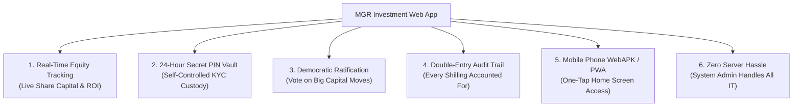
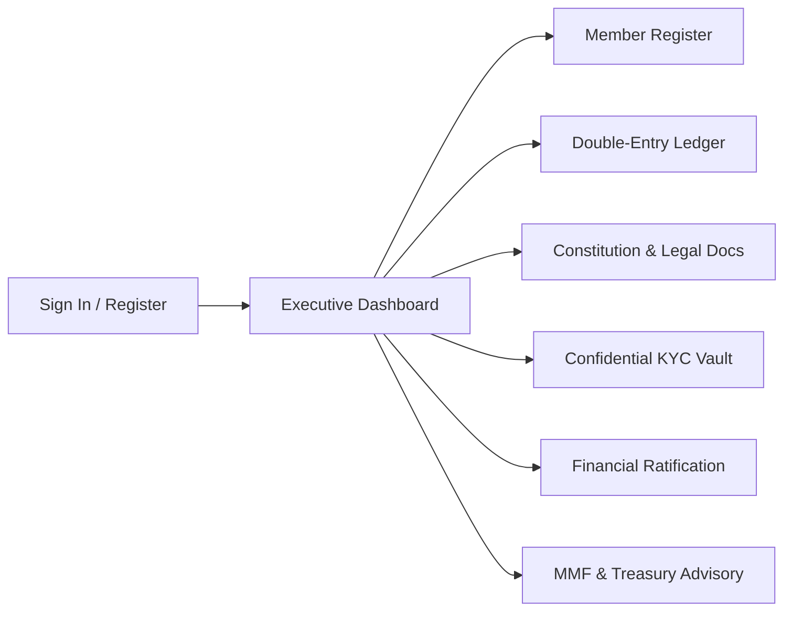
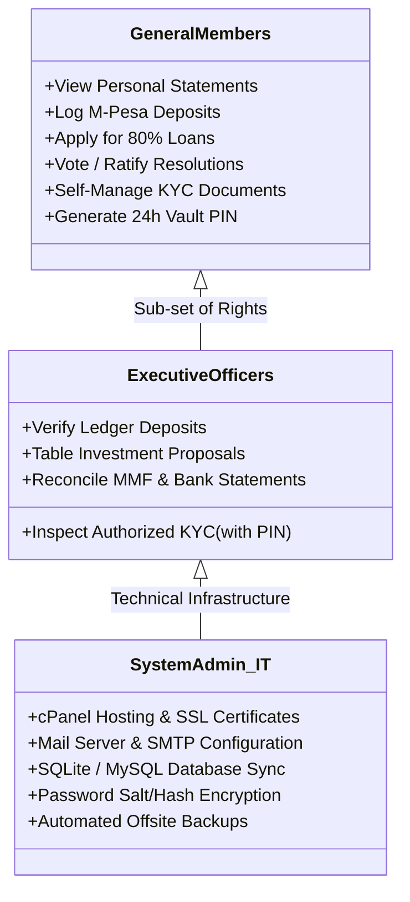

# MGR INVESTMENT GROUP
### MEMBER WEB APPLICATION ORIENTATION MANUAL & CONSULTATIVE GUIDE
**Document Reference:** `MGR/CIR/2026/APP-01`  
**Distribution:** All General Members, Executive Committee & Trustees  
**Status:** **DRAFT FOR MEMBER REVIEW & CONSULTATIVE FEEDBACK (v1.0)**  
**Effective Date:** Financial Year 2026  
**Governing Laws:** Constitution of Kenya (Art. 31), Data Protection Act 2019, Societies Act (Cap 108), Central Bank of Kenya Guidelines

---

> **Consultative Draft Notice:** This document introduces the official **MGR Investment Group Web Application**. It outlines the app's architecture, tools, security safeguards, and mutual advantages. This is **not a finalized directive**—it is circulated to all members to gather suggestions, corrections, and ratification before permanent operational adoption.

---

## 1. Executive Summary & Purpose

The **MGR Investment Group Web Application** is a specialized, institutional-grade portal designed to replace informal messaging, scattered spreadsheets, and manual ledger reconciliations. It provides every member with **24/7 transparent access** to their individual capital, cumulative club assets, audited double-entry books, statutory documents, and democratic ratification votes.

### Core Objectives
1. **Financial Absolute Truth:** Eliminate discrepancies in member share capital, M-Pesa deposits, and yield allocations.
2. **Constitutional Privacy & Data Custody:** Securely warehouse members' sensitive statutory records (National ID, Passport Photo, KRA PIN, Registration forms) with strict compliance to **Article 31 of the Constitution of Kenya (Right to Privacy)** and the **Kenya Data Protection Act 2019**.
3. **Democratic Governance:** Enforce the Club's 3-tier Investment Policy Statement (I.P.S.) and 10-member ratification protocol before major financial reallocations take effect.
4. **Zero Technical Burden on General Members:** All underlying IT operations—cPanel mail dispatch, SMTP delivery, database syncing, encryption, and system maintenance—are handled directly by the **System Administrator (Super Admin / IT Team)**.

---

## 2. Key Advantages for Every Club Member



| Advantage | What This Means for You as a Member |
| :--- | :--- |
| **Instant Equity Visibility** | View your exact share percentage, total deposits credited, and net interest accrued without waiting for annual AGM books. |
| **Member-Controlled Document Privacy** | Your National ID, KRA PIN, and Passport photos cannot be opened or downloaded by *anyone*—including executive leadership—unless you give them a temporary **24-hour expiring PIN**. |
| **Democratic Voting & Ratification** | Major decisions (like moving KES 200,000 from Etica MMF to Mansa X) are recorded digitally with 10-member ratification tracking. |
| **Instant M-Pesa Deposit Logging** | Submit your deposit references directly; once matched against bank/MMF statements, they are permanently audited. |
| **Emergency Credit Eligibility** | Instantly check your qualified 80% unencumbered emergency loan headroom under Club Bylaw Clause 3.2. |
| **Mobile-First Experience** | The application runs smoothly on any smartphone (Android or iPhone) with offline capability and no app store download required. |
| **No IT Maintenance Overhead** | Members do not need to configure mail servers, sync engines, or hosting scripts. The System Administrator manages the cPanel server. |

---

## 3. How to Use the Application: Module-by-Module Breakdown



### Module 1: Sign In & New Member Registration
* **Where to find it:** The opening screen of the application.
* **Dual Segmented Switcher:** 
  - **[ 🔑 Log In ] (Existing Members):** Enter your Member ID (e.g., `MGR-001` through `MGR-011`), registered email, or mobile phone number, along with your password.
    - *Default initial member password:* `MGR@2026` (changeable anytime in your profile).
    - *Founding Member Quick Pre-fill:* An optional collapsible list allowing founding members to pre-fill their ID with one tap.
    - *Password Visibility:* Toggle the eye icon to verify what you have typed.
    - *Email OTP / Forgot Password:* If you forget your password, enter your email to receive a 6-digit verification code dispatched by our cPanel mail server.
  - **[ 👤 Register ] (New Users):** For onboarding new or incoming members.
    - Requires: Full Legal Name, Email Address, Phone Number (M-Pesa), Password, 4-digit Account Security PIN, and consent to the Kenyan Data Protection Charter.

---

### Module 2: Executive Dashboard
* **What it displays:**
  - **Total Club Assets:** Live consolidated valuation across Equity Bank, Etica Capital MMF, and Mansa X Special Funds.
  - **Your Personal Stake:** Displays your exact equity percentage (e.g., `9.09%`), your total deposited share capital, and your prorated interest.
  - **Asset Allocation Progress Bar:** Visual balance showing the distribution across Mansa X (~20% p.a.), Etica MMF (11.08% – 12.50%), and Equity Bank operational cash.
  - **Emergency Liquidity Indicator:** Quick calculation of the club's 20% statutory liquid reserve.

---

### Module 3: Member Register & Personal Statements
* **What it displays:**
  - Complete list of all official members with assigned roles, committee positions, and active standing.
  - Individual financial breakdown: Cumulative deposits, approved loans, accrued yield, and net withdrawable balance.
  - **"My Personal Statement":** Download or print an individualized member statement suitable for banking or official verification.
  - **Log New Deposit:** Enter your M-Pesa transaction code, deposit date, and destination account (Etica MMF, Mansa X, or Equity Bank) for treasurer reconciliation.

---

### Module 4: Double-Entry General Ledger & Audit Trail
* **What it displays:**
  - The formal accounting backbone of MGR Investment Group.
  - Every transaction is recorded using debit and credit entries with strict mathematical equality.
  - Filter by date, quarter, transaction category, or reference code.
  - Searchable audit trail showing the creator, timestamp, and verification status of every entry.

---

### Module 5: Official Documents & Constitution View
* **What it displays:**
  - Full-text interactive viewer and PDF download for all 5 ratified club governance frameworks:
    1. **MGR Club Constitution & LLP Partnership Agreement (Cap 30A)**
    2. **MGR Investment Policy Statement & Objectives (3-Tier Protocol)**
    3. **Emergency Credit, Member Loan & Set-Off Bylaws (80% Limit)**
    4. **Bereavement, Succession & Exit Protocol (Bylaw Clause 4.2)**
    5. **Treasury Yield Prorating & Interest Distribution Policy**
  - Includes statutory dual-signatory mandates, bank ledger fee comparisons, and dispute escalation trees.

---

### Module 6: Confidential Legal KYC Vault & Security PIN
* **What it displays:**
  - A secure digital vault for storing legal identity documents:
    - **National ID / Alien Card**
    - **Passport Photo**
    - **KRA PIN Certificate**
    - **Club Sign-Up & Beneficiary Nomination Forms**
  
> **The 24-Hour Expiring PIN Protocol:**
> 1. Your uploaded documents are **locked by default**.
> 2. No executive officer or fellow member can view or download your files without your secret 4-digit PIN.
> 3. Inside your vault, tap **"Copy Authorization PIN"** to generate a single-use authorization token.
> 4. Once copied, a **24-hour countdown clock** begins.
> 5. An authorized Executive Officer enters this PIN to inspect your documents. After 24 hours, the PIN automatically expires, and the vault relocks.
> 6. You may tap **"Generate New PIN"** at any time to immediately invalidate previous codes.

---

### Module 7: Democratic Financial Ratification
* **What it displays:**
  - Proposed resolutions requiring member consensus (e.g., KES 200,000 capital reallocations, loan approvals, constitutional amendments).
  - Live progress meter tracking approval towards the required 10-member ratification threshold.
  - Audit log showing timestamps and comments of ratifying members.

---

### Module 8: MMF & Treasury Statement Advisory
* **What it displays:**
  - Real-time yield monitoring between **Etica Capital MMF** and **Mansa X Special Funds**.
  - Historical interest yields and compounding schedules.
  - **The 6 Strategic Research Horizons:** Guidance for members to research Fixed Income Funds (FIF), Derivatives, Real Estate Investment Trusts (REITs), Exchange Traded Funds (ETFs), Government Infrastructure Bonds (IFs), and the Nairobi Securities Exchange (NSE).
  - Tactical capital reallocation planner for surplus fund movements.

---

## 4. Mobile Responsiveness & One-Tap Home Screen Installation

The application is engineered as a **Progressive Web Application (PWA / WebAPK)** optimized for mobile phones (Samsung, Tecno, Infinix, Xiaomi, Google Pixel, and iPhone):

```mermaid
flowchart TD
    A["Open App in Mobile Browser"] --> B{"Device Type?"}
    B -->|Android (Chrome)| C["Tap browser menu (⋮) -> 'Install App'<br/>Adds native MGR icon to your App Drawer"]
    B -->|iPhone (Safari)| D["Tap Share button (square with arrow) -> 'Add to Home Screen'<br/>Creates full-screen iOS app"]
    C --> E["Full-Screen Experience with No URL Bar & Fast Local Caching"]
    D --> E
```

* **On Android (Chrome / Edge / Opera):**
  1. Open the portal URL in your mobile browser.
  2. Tap the **"Install Mobile App"** button at the bottom of the sign-in screen, or tap browser settings (`⋮`) and select **"Install App"** / **"Add to Home screen"**.
  3. The app will install directly with the official MGR green-and-gold crest on your home screen.

* **On iPhone (Safari):**
  1. Open the portal URL in Safari.
  2. Tap the **Share** icon (box with upward arrow at bottom of screen).
  3. Scroll down and tap **"Add to Home Screen"**.
  4. Tap **Add**; it now launches in full-screen standalone mode without Safari search bars.

---

## 5. Administrative & Technical Boundary (Zero Server Burden on Members)

To ensure smooth operation and institutional security, responsibilities are cleanly bifurcated:



* **General Members & Executive Officers:** Focus entirely on capital growth, transparent oversight, voting, and club decisions. You do **not** need to understand servers, code, or databases.
* **System Administrator (Super Admin / IT Officer):** Manages technical infrastructure behind the scenes:
  - Configuration of the **cPanel web server**, Apache `.htaccess` security rewrites, and SSL/TLS certificates.
  - Setup of **cPanel Mail Server & SMTP credentials** for automated delivery of OTP verification codes and treasury notifications.
  - Synchronization between local browser storage and the shared **SQLite/MySQL database** (`api.php`).
  - Cryptographic security hashing (bcrypt) of member credentials.
  - Periodic automated off-site backups of the general ledger and document registry.

---

## 6. Call for Member Review & Feedback

This application is built for **you**—the members of MGR Investment Group. Prior to the formal adoption of this portal as the sole binding operating platform, the Executive Committee invites comments on the following questions:

```
┌────────────────────────────────────────────────────────────────────────┐
│               MEMBER FEEDBACK & CONSULTATION CHECKLIST                 │
├────────────────────────────────────────────────────────────────────────┤
│ [ ] 1. Is the 24-hour expiry window for Document Vault PINs practical? │
│ [ ] 2. Are the field labels on the Deposit Logging screen clear?       │
│ [ ] 3. Does the Dashboard layout present your equity stake clearly?    │
│ [ ] 4. Would you like SMS notifications in addition to Email OTP?      │
│ [ ] 5. Any suggestions for additional reports or document exports?     │
└────────────────────────────────────────────────────────────────────────┘
```

Please forward your comments, suggested refinements, or questions to the **Secretary** or **Investment Officer** via the official club WhatsApp forum or directly via email before the next scheduled Executive Committee review.

---
**Authored by:** MGR Executive Committee & Systems Administration  
*MGR Investment Group • Established Under Cap 30A & Kenya Data Protection Act 2019*
