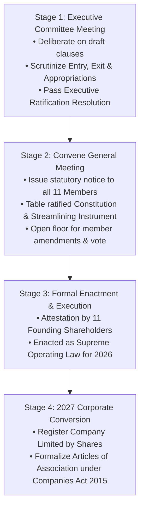
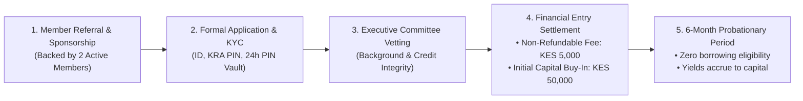
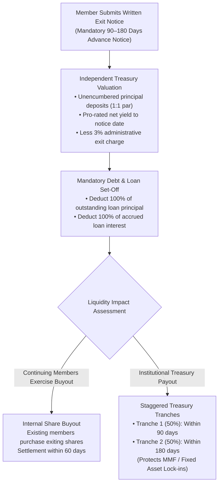
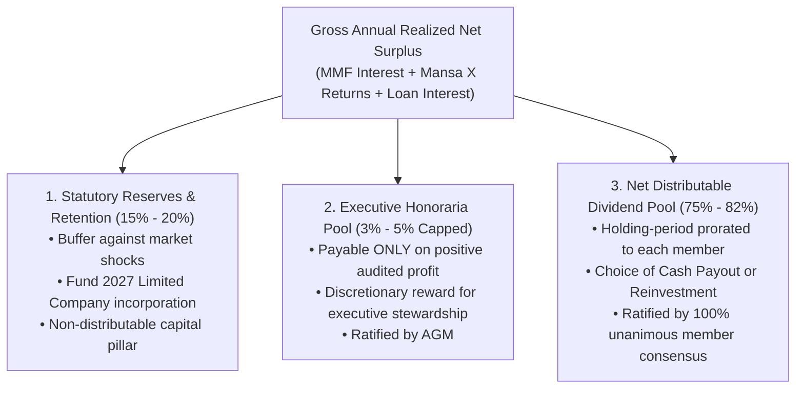

# MGR INVESTMENT GROUP
### STATUTORY POLICY STREAMLINING INSTRUMENT & 2027 CORPORATE ROADMAP
**Document Reference:** `MGR/POL/2026/STREAMLINE-01`  
**Sponsor / Directive:** Office of the CEO & Executive Committee (Directives of John Oballa Ojwang')  
**Distribution:** All 11 Founding Shareholders, Executive Committee, Trustees & Legal Counsel  
**Status:** **EXECUTIVE CONSULTATIVE DRAFT FOR COMMITTEE RATIFICATION & GENERAL MEETING ADOPTION**  
**Governing Laws:** Limited Liability Partnerships Act (Cap 30A), Partnership Act (Cap 29), Companies Act 2015 (No. 17 of 2015), Kenya Data Protection Act 2019

---

> **Executive Mandate & Roadmap Notice:**  
> This instrument incorporates and enacts the official governance directives issued by **CEO John Oballa Ojwang'** on 17th November 2026. It establishes the binding protocol for:
> 1. The **Two-Stage Adoption Process** (Executive Committee Ratification followed by General Meeting Adoption).
> 2. The legal classification of MGR as a **for-profit commercial investment enterprise** and its planned **2027 incorporation as a Private Limited Company by Shares** under the **Companies Act, 2015**.
> 3. The comprehensive streamlining of **Entry Policies**, **Exit & Settlement Policies**, and **Triple Appropriations Policies (Dividends, Executive Honoraria, and Statutory Reserves)**.

---

## 1. Procedural Roadmap for Constitutional Adoption

As directed by the CEO, the formal enactment of the supreme Constitution, Bylaws, and these streamlined policies shall follow an unhurried, transparent two-stage governance workflow:



1. **Executive Committee Convening:** The Executive Committee (Chairperson Dan Aloo, CEO John Oballa Ojwang', Treasurer Sarah Njoki, Secretary Alice Owuor, et al.) shall convene to review, harmonize, and pass an executive resolution recommending the documents for full club adoption.
2. **General Meeting Convening:** Following executive ratification, the Secretary shall issue statutory notice convening a **Special General Meeting (SGM)** of all 11 members to formally debate, vote upon, and adopt the supreme Constitution and these policies by a two-thirds (2/3) constitutional majority.

---

## 2. Entity Nature & 2027 Companies Act Transition Roadmap

### 2.1 Commercial Nature (Profit-Making Enterprise)
* MGR Investment Group is **expressly declared and constituted as a for-profit commercial investment enterprise**.
* It is neither a charitable trust nor a non-profit welfare society; its primary objective is the maximization of return on capital, capital preservation, aggressive compound wealth creation, and generational asset accumulation for its verified shareholders.

### 2.2 2027 Corporate Transition Schedule (Companies Act, No. 17 of 2015)
* **Interim Legal Vehicle (2026):** Operating as an Investment Club / Chama under the *Partnership Act (Cap 29)* and *Limited Liability Partnerships Act (Cap 30A)*, governed by the ratified Constitution, Partnership Agreement, and Double-Entry Ledger.
* **Corporate Registration Milestone (2027):** The Executive Committee is formally mandated to initiate and conclude the incorporation of **MGR INVESTMENT GROUP LIMITED** as a **Private Company Limited by Shares** under the **Companies Act 2015 (Laws of Kenya)** during the 2027 financial year.
* **Transition Parameters:**
  - **Share Capital Structure:** Existing member net capital balances (standing at KES 710,675.00+ as of FY 2026) shall convert into fully paid-up Ordinary Shares of equal par value (e.g., KES 100 or KES 1,000 per share) registered in the names of the 11 founding shareholders.
  - **Articles of Association:** The clauses of this Constitution and the streamlined policies herein shall be codified as the Company's Articles of Association.
  - **Board of Directors:** The Executive Committee shall transition into the initial Board of Directors, with statutory duties of care, skill, and fiduciary loyalty prescribed by Sections 142–148 of the Companies Act 2015.
  - **Regulatory Compliance:** Annual statutory returns, corporate tax filings with Kenya Revenue Authority (KRA), audited company accounts, and formal share certificates shall be issued to all members.

---

## 3. Streamlined Policy A: Entry Clause & Membership Vetting



### 3.1 Eligibility & Qualification
1. Any prospective candidate must be a natural person of sound mind, aged 18 years and above, of demonstrated financial integrity, and committed to disciplined monthly capital contributions.
2. Every applicant must be formally sponsored and seconded in writing by at least **two (2) active founding members in good standing**.

### 3.2 Vetting & Admission Procedure
1. **Application & KYC Submission:** The applicant must complete the official Club Admission Form and upload verified legal documents (National ID, Passport Photo, KRA PIN Certificate, and Next-of-Kin nomination) to the confidential KYC Vault under Kenya Data Protection Act 2019 standards.
2. **Executive Committee Scrutiny:** The Executive Committee shall conduct character due diligence, financial background vetting, and consensus appraisal. Admission requires a unanimous affirmative recommendation from the Executive Committee.
3. **General Membership Ratification:** The applicant's dossier shall be presented to the General Membership and ratified by not less than two-thirds (2/3) of all members.

### 3.3 Financial Entry Obligations
1. **Non-Refundable Registration Fee:** A mandatory, non-refundable administrative registration fee of **KES 5,000** shall be paid directly to the Club's clearing account (credited to the Club Reserves to defray administrative and onboarding costs).
2. **Initial Share Capital Buy-In:** To prevent dilution of founding member equity, the new entrant must contribute a minimum initial share capital buy-in of **KES 50,000** (payable in a lump sum or in approved installments over not more than three months) before shares are allocated.
3. **Equalization Principle:** Any new member entering an ongoing financial year shall be subject to the holding-period proration rules, receiving dividend allocations strictly from the date their capital is deployed into interest-earning assets.

### 3.4 Probationary & Vesting Restrictions
* **Six (6) Months Probationary Window:** A newly admitted member shall remain on probation for the first six (6) calendar months. During this probationary window:
  - The member shall **not be eligible to borrow** emergency loans under Clause 10.5.
  - The member shall **not be eligible for nomination** to the Executive Committee.
  - All investment yield earned during probation shall be automatically capitalized (compounded) into share capital and cannot be withdrawn in cash.

---

## 4. Streamlined Policy B: Exit Clause, Valuation & Settlement



### 4.1 Categorization of Exit
1. **Voluntary Withdrawal:** A member willingly electing to terminate membership.
2. **Involuntary Expulsion:** A member expelled by a 2/3 majority resolution for gross misconduct, breach of trust, continuous contribution default exceeding three (3) months, or willful disruption of club unity.
3. **Bereavement / Estate Exit:** Transmission of member capital upon death or permanent mental incapacity, governed strictly by the *MGR Bereavement, Succession & Exit Protocol*.

### 4.2 Notice Period & Cooling-Off
1. A member electing voluntary withdrawal must deliver not less than **ninety (90) to one hundred and eighty (180) days' written notice** to the Secretary and CEO.
2. The extended notice window is legally mandatory to protect the Club from forced, untimely liquidation of fixed-income instruments, infrastructure bonds (IFBs), or money market funds that attract early-redemption penalties.
3. During the notice period, the member's capital remains invested but shall cease to participate in voting or new loan applications.

### 4.3 Valuation Methodology (Fair & Equitable Formula)
The exit settlement value shall be computed strictly on the date of notice expiry based on audited book balances:
$$\text{Net Exit Entitlement} = \text{Verified Share Deposits} + \text{Prorated Net Yield} - \text{Mandatory Set-Offs} - \text{Administrative Exit Levy}$$
Where:
- **Share Deposits:** Computed at 1:1 par value of verified net deposits.
- **Prorated Net Yield:** Accrued compound interest up to the date of notice expiry.
- **Administrative Exit Levy:** A deduction of **three per cent (3%)** of gross entitlements to defray legal, audit, and transaction costs incurred by the Club.
- **Forfeiture of Reserves:** An exiting member has no claim over the Club's accumulated statutory reserve funds, which remain the permanent property of the continuing entity.

### 4.4 Mandatory Right of Set-Off
* Under no circumstances shall an exiting member be paid any exit entitlement while holding an outstanding emergency loan or unfulfilled financial obligation.
* The Treasurer shall automatically exercise the Club's **supreme right of set-off**, deducting 100% of outstanding loan principal and accrued 10% monthly interest from the capital account before calculating net dues.
* If liabilities exceed the member's capital, the deficiency remains a legally actionable civil debt recoverable under Kenyan contract law.

### 4.5 Payout Schedule & Internal Share Purchase Rights
1. **Right of First Refusal (Internal Buyout):** Prior to drawing cash from treasury accounts, the exiting member's shares shall be offered pro-rata to the continuing 10 members at 1:1 par value. Continuing members may purchase the exiting shares to increase their equity stake.
2. **Staggered Payout Tranches:** Where the Club settles from institutional treasury funds, settlement shall occur in two equal tranches to preserve operational liquidity:
   - **First Tranche (50%):** Disbursed within ninety (90) days following valuation sign-off.
   - **Second Tranche (50%):** Disbursed within one hundred and eighty (180) days.

---

## 5. Streamlined Policy C: Triple Appropriations Policy



### 5.1 Sub-Policy 1: Dividend Policy
1. **Source of Dividends:** Dividends shall be declared and paid **strictly out of audited, realized net operating profits and investment yields**. No dividend shall ever be paid out of principal member capital deposits.
2. **Formula of Attribution:** In compliance with the *Treasury Yield Prorating Policy*, dividends shall be allocated pro-rata based on:
   - The qualifying capital balance standing to each member's credit.
   - The exact active holding period (calendar days) such capital was deployed.
   - Zero yield attribution to new deposits made after the quarterly closing date.
3. **Distribution vs. Reinvestment (Compounding):**
   - Each member shall elect whether to receive their dividend in cash (disbursed to their registered M-Pesa / Bank account within 14 days of AGM ratification) or to automatically compound 100% into their share capital balance.
   - Default Option: In the absence of written instruction, dividends are automatically capitalized to accelerate compound wealth growth.
4. **Approval Gate:** The final dividend schedule prepared by the Treasurer requires formal executive endorsement and **100% unanimous ratification** by all active members.

### 5.2 Sub-Policy 2: Executive Honoraria Policy
1. **Philosophical Justification:** While MGR is built on mutual solidarity, executive officers (Chairperson, CEO, Treasurer, Secretary, Research Officer) bear significant fiduciary liability, operational workload, financial reconciliation duties, and legal compliance burdens. A formal, transparent honoraria mechanism rewards performance while preventing arbitrary withdrawals.
2. **Strict Pre-Conditions for Honoraria:**
   - **No Profit, No Honoraria:** Honoraria shall **never be paid in any financial year where the Club incurs an operating loss, capital deficit, or negative cash flow**.
   - **Performance Benchmark:** The Club's net yield across all investment assets must exceed the prevailing Central Bank of Kenya (CBK) 91-day Treasury Bill rate for the year.
3. **Cap on Honoraria Pool:**
   - The total aggregate honoraria pool for all serving officers shall be **strictly capped at not more than five per cent (5%)** of audited net annual investment surplus (or a modest flat stipend recommended by the Treasurer).
   - Under no circumstances shall honoraria exceed the 5% statutory ceiling.
4. **Ratification & Transparency:**
   - The proposed honoraria schedule must be explicitly disclosed in the Annual Financial Report and ratified by the General Meeting during the AGM.
   - Any officer receiving honoraria remains fully accountable to the double-entry ledger audit trail.

### 5.3 Sub-Policy 3: Reserves & Retention Policy
1. **Mandatory Retention Rate:** The Club shall mandatorily deduct and retain **between ten per cent (10%) and twenty per cent (20%)** of every periodic net surplus prior to dividend or honoraria declarations.
2. **Statutory Purposes of the Reserve Fund:**
   - **Capital Fortification:** Protect the principal capital of members against unexpected market fluctuations, inflation, or temporary yield compression in commercial MMFs.
   - **Emergency Liquidity Buffer:** Ensure the Club continuously maintains at least 2% to 5% operational liquidity with Equity Bank to service approved 30-day emergency borrowings without disturbing 6-month MMF lock-ins.
   - **2027 Incorporation & Compliance Fund:** Accumulate necessary legal, filing, registrar, and consultancy funds required to register **MGR INVESTMENT GROUP LIMITED** under the Companies Act 2015.
3. **Non-Distributable Character:**
   - The Reserve Fund constitutes the indivisible institutional wealth of the Club.
   - It cannot be claimed, divided, or withdrawn by any exiting or retiring member.
   - In the event of formal corporate transformation in 2027, the Reserve Fund shall seamlessly convert into the Company's Retained Earnings & Capital Reserves.

---

## 6. Executive Action Matrix: Convening Roadmap

| Milestone | Action Item | Responsible Official | Target Deadline |
| :--- | :--- | :--- | :--- |
| **Milestone 1** | Convene Executive Committee Meeting to debate and formally ratify this Streamlining Instrument | CEO (John Oballa) & Chairman (Dan Aloo) | Within 14 Days |
| **Milestone 2** | Issue statutory 14-day notice convening the Special General Meeting (SGM) of all 11 Members | Secretary (Alice Owuor) | Post-Executive Meeting |
| **Milestone 3** | Table Constitution & Streamlining Instrument at SGM for democratic member debate and 2/3 adoption | Executive Committee & General Membership | SGM Assembly |
| **Milestone 4** | Complete physical and cryptographic attestation signatures of all 11 founding members | Secretariat & Legal Counsel | Within 7 Days Post-SGM |
| **Milestone 5** | Initiate legal documentation and name reservation for 2027 Company Limited by Shares conversion | CEO, Treasurer & Legal Counsel | Q1 2027 |

---

## 7. Attestation & Governance Endorsement

This Statutory Policy Streamlining Instrument is formally tabled for executive adoption:

```
For the Executive Committee:

___________________________           ___________________________
DAN ALOO                              JOHN OBALLA OJWANG'
Executive Chairman                    Chief Executive Officer (CEO)

___________________________           ___________________________
SARAH NJOKI                           ALICE OWUOR
Treasurer                             Secretary
```

*MGR Investment Group • Operational Instrument REF: MGR/POL/2026/STREAMLINE-01*  
*Enacted in Nairobi, Republic of Kenya • Governed by Cap 30A & Companies Act 2015*

